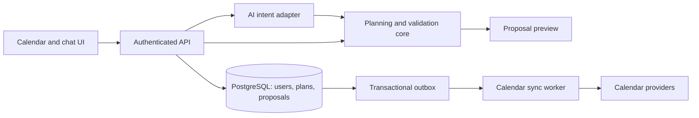

# Architecture — provisional

Start as a modular application with one planning service. Keep language-model reasoning outside the deterministic rules that commit schedule changes. Scale based on measurements rather than splitting every module into a service.

Only the planning core and adapter interfaces exist today. Everything else in the diagram is a planned boundary.

## Modules and ownership boundaries

| Module | Responsibility | Must not do |
| --- | --- | --- |
| Web | Render week, chat, proposal diff, confirmations | Hold provider secrets or silently commit plans |
| API | Authenticate, authorize, validate commands, rate limit | Trust user IDs supplied in request bodies |
| Intent adapter | Convert text into a typed intent or clarification | Write the database or call mutating calendar tools |
| Planning core | Constraints, affected items, conflicts, proposal revisions | Depend on a model for correctness |
| Recommendation modules | Suggest meals/clothes from explicit preferences and context | Invent available food, wardrobe, or allergy facts |
| Persistence | Atomic plan revision, proposal, audit entry, outbox record | Apply partial updates |
| Worker | Retry idempotent external synchronization | Treat provider success as a database transaction |

## Data model to implement

- User: ID, IANA timezone, preferences, consent/settings.
- Plan: ID, user ID, monotonically increasing revision.
- PlanItem: ID, plan ID, owner, kind, title, UTC interval, fixed flag, optional dependency.
- Routine: local wall-clock recurrence rule, IANA timezone, exceptions; separate from individual occurrences.
- Proposal: owner, plan ID, base revision, before/after changes, reason, status, expiry.
- ChangeSet: immutable audit record, actor, applied revision, request ID; drives undo proposals.
- ProviderConnection: owner, provider, encrypted tokens, sync cursor.
- OutboxEvent: owner, change set, operation ID, delivery status and retry metadata.

Index plan items by owner/plan/start; enforce ownership and uniqueness in storage, not only application code. Row-level security can provide defense in depth. Production apply uses one database transaction with a revision check and unique idempotency key. The current in-memory Planner is deliberately single-process and is neither persistent nor thread-safe.

## Time and scheduling semantics

The prototype accepts aware datetimes, rejects nonexistent local times where timezone data identifies them, compares UTC instants, and shifts direct dependencies by equal elapsed duration. Explicit DST folds identify resolved instants. All items are exclusive time blocks; adjacent blocks are allowed. It does not choose another time when a conflict occurs. One-level dependencies only are allowed. It preserves meal/clothing content while moving preparation times; it does not generate new recommendations. Applying requires the literal boolean `True`, not another truthy value.

Production stores an IANA timezone alongside UTC instants and resolves local times before calling the core. Reject ambiguous/nonexistent local times until clarified. Recurrence must preserve intended local wall-clock time across daylight saving transitions; elapsed-time shifting is not a recurrence engine.

## Scaling path

1. One deployable API, PostgreSQL, and one worker. Use bounded AI calls with timeouts, schema validation, cancellation, and user quotas.
2. Add stateless API replicas and workers when latency/queue metrics justify them. Serialize commits per plan through database revision checks.
3. Use an outbox for calendar synchronization; exponential backoff, retry limits, dead-letter handling, and visible sync status. Never claim database/provider atomicity.
4. Cache suitable weather/reference context; key any private cache by owner. Batch calendar reads and honor provider rate limits.
5. Measure proposal latency, conflict rate, model token cost, correction rate, and sync lag. Establish numeric budgets before release.
6. Partition high-volume tables or extract services only after measured bottlenecks. Test backup restoration and data deletion before public launch.

## AI evaluation and privacy

Maintain synthetic fixtures covering ambiguous dates, multiple matching events, unavailable times, DST transitions, invalid tool output, prompt injection in event titles, and preference constraints. Version prompts alongside code. A new model/prompt must pass command-extraction and clarification evaluations before rollout. Log request IDs and aggregate metrics rather than raw calendar/chat contents. Define retention/deletion and token encryption before enabling external accounts.
